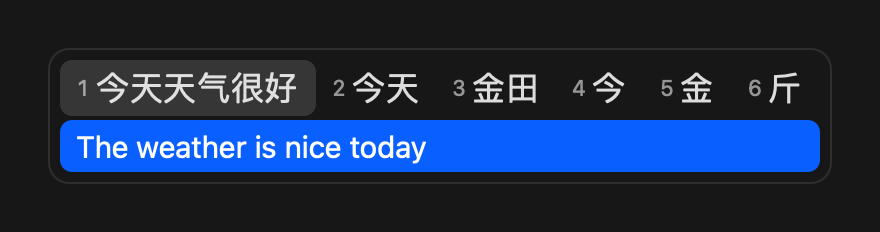

<p align="center">
  
</p>

<h1 align="center">字游 Zyo</h1>

<p align="center">
  边打字边翻译的 macOS 输入法 · 完全离线<br>
  <em>A macOS input method that translates as you type — fully offline, powered by Apple Translation.</em>
</p>

<p align="center">
  <a href="https://github.com/owenuone/Zyo/releases/latest">下载</a> ·
  <a href="#使用">使用</a> ·
  <a href="#从源码编译">从源码编译</a>
</p>

打拼音时，候选窗第一行是候选词，第二行是**当前高亮候选的实时译文**。选候选就上屏中文，选译文就上屏外语。

<p align="center">
  
  
</p>

## 特性

- **实时两行候选**：只翻译当前高亮的候选，切换高亮译文跟着变
- **完全离线**：翻译使用 macOS 自带的 Apple Translation，输入内容不离开本机
- **全拼 / 双拼 / 五笔**：基于 [librime](https://github.com/rime/librime) 和 [雾凇拼音](https://github.com/iDvel/rime-ice)，支持全拼（自带简拼，如 `nh` → 你好）、小鹤 / 微软 / 自然码双拼，以及五笔 86、五笔 98、新世纪五笔（`z` 键拼音反查）
- **整句翻译**：选中的词先攒成整句，拼完一起翻译、一起上屏（可在设置中关闭）
- **双向翻译**：单按 Shift 在 中文 → 外语 和 外语 → 中文 之间切换
- **18 种外语**：英、德、法、西、意、葡、荷、波兰、土耳其、印尼、越南（双向）；日、韩、俄、乌克兰、阿拉伯、泰、印地（仅 中文 → 外语）
- **直接英文**：Caps Lock 循环切换 字游 → 英文小写 → 英文大写，不用切换输入法
- **词库自动更新**：每天在后台更新雾凇拼音词库
- 键盘和鼠标都能选，深色 / 浅色外观自动适配

## 安装

需要 **Apple Silicon** 和 **macOS 26** 或更高版本。

1. 从 [Releases](https://github.com/owenuone/Zyo/releases/latest) 下载 `Zyo-<版本>.zip` 并解压
2. 在终端进入解压出的 `Zyo` 文件夹，运行：
   ```bash
   bash install.sh
   ```
3. **添加输入法**：系统设置 → 键盘 → 输入法 → 编辑 → `+` → 简体中文 → **字游**（英文系统下显示为 Zyo）
4. **下载离线语言包**：菜单栏输入法图标 → 设置… → 翻译语言，点击「下载」

首次切换到字游时会部署词库，几秒内打字会提示「词库部署中」。App 未经公证，安装脚本会去掉隔离标记。

> 如果按 Caps Lock 切到了 ABC 而不是直接英文，在输入法编辑界面关闭「使用大写锁定键切换"ABC"输入法」。

## 使用

| 按键 | 作用 |
|------|------|
| `1`–`6` / `Space` | 选择候选词（开启「整句翻译」时先进入整句，拼完后再按 `Space` 上屏） |
| `←` / `→` | 切换高亮候选，译文随之更新 |
| `-` / `=` | 翻页 |
| `↓` / `Tab` | 选中译文行，再按 `Space` / `Enter` 上屏译文 |
| `↑` | 从译文行回到候选行 |
| `Enter` | 上屏当前整句和高亮候选 |
| `Backspace` | 删除一个字母；拼音选完后删除整句的最后一个字 |
| `Esc` | 在候选行取消输入；在译文行回到候选行 |
| 单按 `Shift` | 切换翻译方向（中文 → 外语 ⇄ 外语 → 中文） |
| `Caps Lock` | 循环切换 字游 → 英文小写 → 英文大写 |

鼠标点击候选词或译文行也可以直接上屏。

输入方案、整句翻译和外语在 **菜单栏输入法图标 → 设置…** 中选择。

## 已知限制

- 外语 → 中文 方向只能输入 ASCII 字母，带重音的字符（é、ü、ñ）和越南语声调无法输入
- 日、韩、俄等非拉丁字母语言的 外语 → 中文 方向按 英语 → 中文 处理
- Apple 按语言组打包翻译模型，换到不同组的外语时，系统可能要求重新下载中文
- 密码输入框中 macOS 会禁用第三方输入法

## 隐私

翻译全部在本机完成。唯一的联网操作是每天从 GitHub 下载雾凇拼音词库，不发送任何输入内容。

## 卸载

```bash
killall Zyo; rm -rf ~/Library/Input\ Methods/Zyo.app
rm -rf ~/Library/Application\ Support/Zyo ~/Library/Logs/Zyo
```

然后在 系统设置 → 键盘 → 输入法 中移除字游。从源码安装的也可以用 `make uninstall` 代替第一行。

## 从源码编译

需要 [Homebrew](https://brew.sh) 和 Xcode Command Line Tools（`xcode-select --install`），不需要完整的 Xcode。

```bash
brew install librime
git clone https://github.com/owenuone/Zyo.git
cd Zyo
make install
```

`make install` 会下载雾凇拼音和五笔词库、编译、安装到 `~/Library/Input Methods/`，并预先编译词库。

```bash
make build      # 编译并组装 build/Zyo.app
make install    # 安装并重启输入法进程
make test       # 运行单元测试
make dist       # 打包自带依赖的分发版 build/Zyo-<版本>.zip
make log        # 查看实时日志
```

架构和设计细节见 [CLAUDE.md](CLAUDE.md)。

## 致谢

- [librime](https://github.com/rime/librime)：Rime 输入法引擎（BSD-3-Clause）
- [雾凇拼音 rime-ice](https://github.com/iDvel/rime-ice)：词库与输入方案（GPL-3.0）
- [极点五笔 86 rime-wubi86-jidian](https://github.com/KyleBing/rime-wubi86-jidian)：五笔 86 方案与词库（Apache-2.0）
- [rime-wubi98](https://github.com/lotem/rime-wubi98)：五笔 98 方案与词库（GPLv3）
- [wubi06_rime](https://github.com/byujiang/wubi06_rime)：新世纪五笔词库（GPL-3.0）
- Apple Translation：离线翻译

## 许可证

[GPL-3.0](LICENSE)。安装包内打包了 GPL-3.0 授权的雾凇拼音、五笔 98 和新世纪五笔词库，因此本项目同样采用 GPL-3.0。
